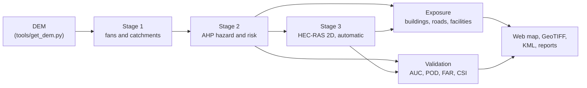
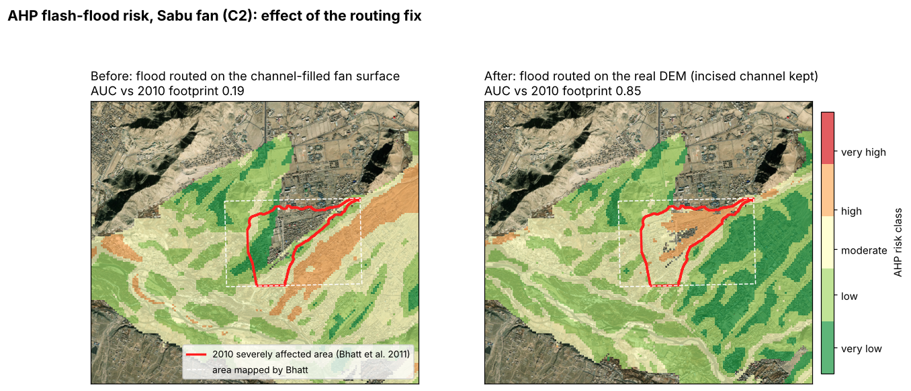
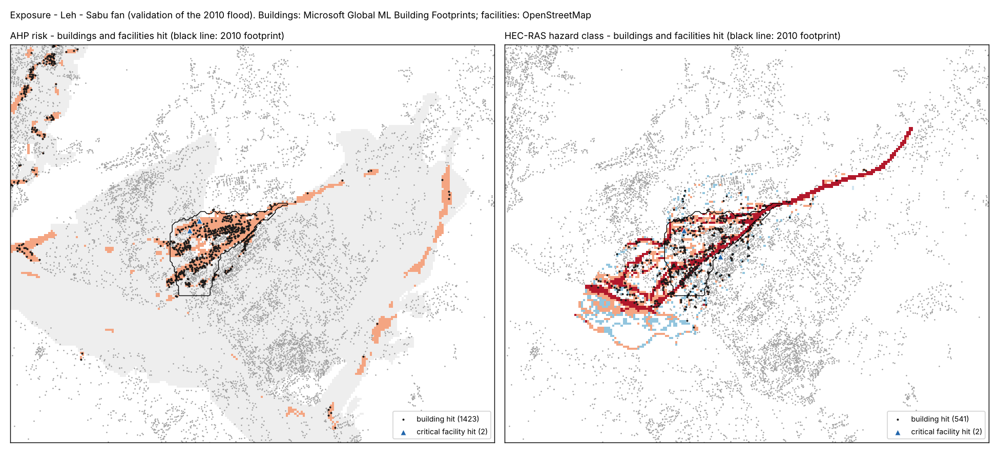
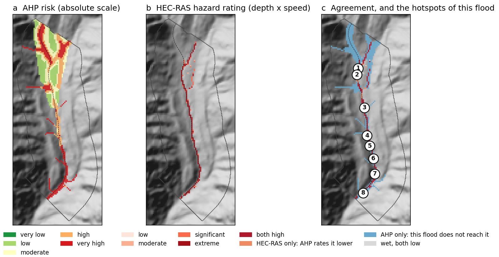

# fanrisk: flash-flood risk on alluvial fans, from a DEM

**fanrisk** maps flash-flood risk for settlements built on alluvial fans in mountain valleys. It starts from nothing but a digital elevation model (DEM) and gives you:

- the fans and the catchments that feed them, found automatically;
- AHP (Analytic Hierarchy Process) hazard and risk maps for every fan;
- a ready-to-run HEC-RAS 2D model of the main flood path, run in batch, with maximum depth, speed and hazard maps;
- the buildings, roads, schools and hospitals in harm's way;
- scores against an observed flood, and a web map you can open in any browser.

It was built and tested on the **August 2010 Leh cloudburst** (Sabu–Choglamsar fan, Ladakh). It was then run with no tuning on two more events: the **5 August 2025 Dharali debris flow** (Uttarkashi) and the **June 2013 Kedarnath flood** (Rudraprayag), where the whole chain including HEC-RAS was run with default settings to check that nothing is tuned to Leh.

ICTD 2026–27 project, IIT Delhi: Akhtar Hussain and Saharsh Laud (guide: Prof. Aaditeshwar Seth).



---

## What it found for Leh 2010

| Map | AUC vs the 2010 flood | Flooded area flagged (POD) | False alarms (FAR) |
| --- | --- | --- | --- |
| AHP risk map, "high" and above | **0.85** | 0.59 | 0.16 |
| HEC-RAS 2D, depth ≥ 0.3 m (2 m channel burn, n = 0.06) | **0.77** | 0.51 | 0.34 |

- **HEC-RAS at the gauged Sabu section** (Thayyen et al. 2013): depth 5.04 m against 5.2 m observed.
- **Robust to the expert weights:** AUC 0.82–0.85 across 423 random variations of the AHP pairwise judgements.
- **Robust to roughness:** AUC 0.76–0.77 for Manning's n from 0.04 to 0.08.
- **Exposure, from today's buildings** (Microsoft footprints):
  - 541 buildings sit in water 0.3 m or deeper, 200 of them in the "extreme" hazard class.
  - 8.7 km of road floods.
  - The Leh District Jail is in the extreme class.




Open `results/leh_2010/viewer.html` in a browser for the interactive map. You can switch the layers on and off, and click any building for its hazard class and depth.

## What it found for Dharali 2025 (second event, no tuning)

| Check | fanrisk | Published |
| --- | --- | --- |
| Fan found fully automatically | **no** (narrow trunk valley, see Limitations) | - |
| With one manual fan apex: catchment area | 18.3 km² | 17 km² (Kumar et al. 2026) |
| Melton ruggedness | 0.82 | 0.80 |
| Flow type | **debris flow** | debris flow |
| Risk within 250 m of the deposit | 46% of cells high or above, highest score 0.77 | - |

For Leh the same defaults give a clear-water flood, which is also correct.

## What it found for Kedarnath 2013 (bias test, full chain with HEC-RAS)

Default humid-mountain settings, the tool's own SCS storm hydrograph (210 mm in 12 h at Chorabari, Singh et al. 2015), no channel burn, default model size, the HEC-RAS template re-fitted to a new UTM zone (44N). Nothing taken from Leh.

| Check | Kedarnath | Leh, for comparison |
| --- | --- | --- |
| Trunk fan found fully automatically | **no** (needs one manual apex, as at Dharali) | yes |
| Catchment at the apex; at the town | 18.6 km²; 38.6 km² (reaches the published 67 km² valley area 5.5 km downstream) | - |
| Melton ruggedness; flow type | 0.72; debris flow | 0.30; clear-water flood |
| Peak inflow, R04 clear water; R05 bulked for debris | 109; 199 m³/s | 1,070 m³/s (observed) |
| Depth and speed through the town | 1.6–2.6 m, 5–6 m/s (extreme hazard) | - |
| Water against the model edge; volume error | none; < 0.01% | none |
| HEC-RAS significant/extreme cells that the AHP rates high or very high | **89%** | - |
| AUC of the AHP risk map against the simulated flood | **0.73–0.75** | 0.83–0.86 |

The AHP flags all seven feeders of the fan complex, while HEC-RAS simulates one, which explains most of the lower agreement. The test found one Leh-only step in the code: the outflow boundary was lengthened along a single edge of the model outline. It now follows the outline round corners (`fanrisk/ras/geometry.py`). No AHP weight or HEC-RAS parameter was changed. The inflow is rain only; the Chorabari lake outburst is not modelled, so these flows are a lower bound.



---

## Install

You need Python 3.10 or newer.

```bash
git clone https://github.com/SaharshLaud/fanrisk.git
cd fanrisk
pip install -e ".[geo]"            # numpy, rasterio, geopandas, matplotlib
python tests/selftest.py            # checks the install
```

The HEC-RAS stage is optional and needs:

- Windows, with [HEC-RAS 7.0.2](https://www.hec.usace.army.mil/software/hec-ras/download.aspx) installed. Open it once and click **I Agree**.
- The extra Python packages: `pip install -e ".[hecras]"` (ras-commander, psutil, h5py, scipy).

## Your own valley in four commands

```bash
python tools/get_dem.py 30.93 78.70 31.12 78.92 mysite/dem.tif   # south west north east; free Copernicus 30 m DEM, no account
python -m fanrisk init mysite                                      # writes mysite/site.toml
python -m fanrisk run mysite/site.toml                             # fans -> AHP risk maps (+ HEC-RAS package if switched on)
python -m fanrisk viewer mysite/site.toml                          # one HTML web map of the results
```

Set the region profile in `site.toml`: `arid_mountain`, `humid_mountain` or `generic`. Add a storm (`rainfall_mm`, `duration_min`) for peak flows. Add `manual_apexes` if the detector misses a fan you know about.

Then, if you want:

```bash
python -m fanrisk hecras fit   mysite/site.toml --spacing 15     # builds the HEC-RAS model from the bundled template
python -m fanrisk hecras smoke mysite/site.toml                  # 10-minute test run
python -m fanrisk hecras run   mysite/site.toml                  # all scenarios -> Max maps -> scores
python -m fanrisk validate     mysite/site.toml --maps <run>/maps   # AUC etc. against an observed flood footprint
python -m fanrisk compare      mysite/site.toml --run R04          # AHP vs HEC-RAS agreement, hotspots, KML
python -m fanrisk exposure     mysite/site.toml --osm map.osm      # buildings, roads, facilities hit
python tools/check_event.py    mysite/site.toml --lon .. --lat .. --catchment-km2 ..   # check against published numbers
```

## Reproduce the paper's results

On Windows, double-click the batch files in this folder. Each one writes a `*_status.txt` file and stops at the first error.

| File | What it does | Needs HEC-RAS | Time |
| --- | --- | --- | --- |
| `run_selftest.bat` | Checks the install | no | 1 min |
| `run_maps_only.bat` | Leh: fans, AHP risk maps, HEC-RAS package | no | 30 s |
| `run_leh_chain.bat` | Leh: everything, including the HEC-RAS model and runs | yes | about 30 min |
| `run_validate.bat` | Scores the maps against the 2010 footprint | no (uses run R04) | 1 min |
| `run_exposure.bat` | Buildings, roads and facilities hit (downloads Microsoft buildings once) | no | 1 min |
| `run_viewer.bat` | Builds the web map and opens it | no | 10 s |
| `run_burn_test.bat` | Experiment: channel burned 0, 2 and 4 m into the terrain | yes | about 10 min |
| `run_roughness_test.bat` | Experiment: Manning's n = 0.04 and 0.08 | yes | about 8 min |
| `run_dharali.bat` | Second event: downloads the DEM, then runs automatic and manual-apex checks | no | 2 min |
| `run_kedarnath.bat` | Third event: downloads the DEM, then runs automatic and manual-apex checks | no | 2 min |
| `run_kedarnath_hecras.bat` | Kedarnath bias test: HEC-RAS model built in a new UTM zone, runs R04 and R05, scores | yes | about 1 h |

On Linux or macOS, run the same `python -m fanrisk ...` lines from the `.bat` files. HEC-RAS itself needs Windows.

## Repository layout

```
fanrisk/            the package: engine (stages 1-2), pipeline, ras/ (HEC-RAS fit, batch, readback, HDF maps), validate, exposure, viewer
  profiles/         region profiles (arid_mountain, humid_mountain, generic)
  cases/            observations of documented floods (leh_2010), used only for testing
  templates/hecras/ the minimal HEC-RAS 7.0.2 project that 'hecras fit' re-targets
tools/              get_dem, get_ms_buildings, check_event, case_summary
examples/           leh_2010 (with experiments/), dharali_2025, kedarnath_2013
data/               Leh DEM, the 2010 footprint and damage points, OpenStreetMap extract
results/            outputs of our runs: figures, web maps, scores, exposure lists
tests/selftest.py
```

Settings live in four layers, each overriding the one before:

1. method defaults (`fanrisk/defaults.py`);
2. the region profile;
3. your `site.toml`;
4. its `[advanced]` section.

The run log lists every setting that differs from the defaults and where it came from. Leh is a validation case, not a default.

## Limitations

- **Narrow trunk valleys.** The apex detector looks for a channel leaving a confined valley onto open ground. Where the main valley is itself a gorge (Dharali, Kedarnath), it misses the trunk fan. Give the apex by hand (`manual_apexes`).
- **Terrain resolution.** A 27–30 m DEM is about as wide as the channels. HEC-RAS uses a channel burned 2 m into the terrain, chosen by testing 0, 2 and 4 m against the 2010 flood.
- **Clear water only.** The HEC-RAS runs use clear-water flow. Debris flows (Bingham rheology) are not run, and the Dharali check stops at the AHP stage.
- **Lake outbursts.** Glacial-lake outburst floods are not modelled; at Kedarnath the inflow is rain only.
- **No structures.** Road embankments, culverts and bridges are not in the terrain.
- **Uniform roughness.** HEC-RAS uses one Manning's n (0.06) for the whole area.
- **Maps from the HDF file.** If HEC-RAS's own map export is blocked (for example by Windows Defender), maps are made directly from the results file. Depths agree with HEC-RAS's maps within 0.11 m on average. Compare runs made the same way.
- **Today's buildings.** The exposure layers show buildings standing today, not in 2010.

## Data and credits

| Data | Source and licence |
| --- | --- |
| DEM | Copernicus GLO-30 © DLR e.V. 2010–2014 and © Airbus Defence and Space GmbH 2014–2018, provided under COPERNICUS by the EU and ESA ([AWS open data](https://registry.opendata.aws/copernicus-dem/)) |
| Roads and facilities | © OpenStreetMap contributors, ODbL |
| Buildings | [Microsoft Global ML Building Footprints](https://github.com/microsoft/GlobalMLBuildingFootprints), ODbL |
| 2010 footprint and damage points | Traced by us from Bhatt et al. (2011), Fig. 7 |
| Leh hydrograph and Sabu observations | Thayyen et al. (2013), *Natural Hazards*, doi:10.1007/s11069-012-0464-2 |
| Dharali facts | Kumar et al. (2026), *Current Science* 130(3), 229–238; ISRO (2025); NRSC/NDEM (2025) |
| Kedarnath facts | Singh et al. (2015), *Natural Hazards and Earth System Sciences* 15, 1597–1601, doi:10.5194/nhess-15-1597-2015 |
| Background imagery in the figures and web maps | © Esri, Maxar, Earthstar Geographics (Esri World Imagery) |
| HEC-RAS | US Army Corps of Engineers; driven through [ras-commander](https://github.com/gpt-cmdr/ras-commander) |

If you use fanrisk, please cite it (see `CITATION.cff`).

## Licence

MIT, see `LICENSE`. The data in `data/` and `results/` keep the licences of their sources listed above.
